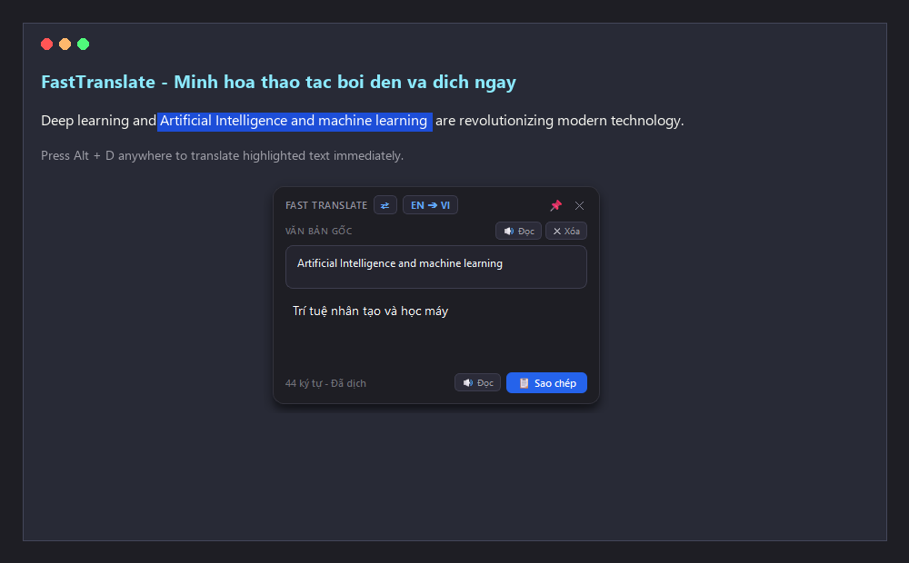
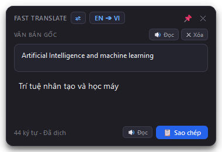
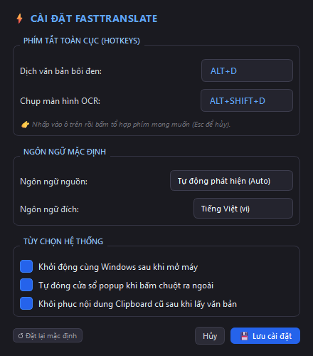
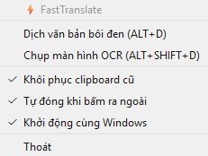

# ⚡ FastTranslate - Dịch thuật nhanh trên Windows

Phần mềm dịch thuật tức thì chạy ngầm trên Windows với giao diện Dark Mode hiện đại, hỗ trợ dịch văn bản bôi đen bất kỳ đâu (`Alt + D`) và chụp màn hình nhận diện chữ OCR (`Alt + Shift + D`).

---

## 📸 Giao diện phần mềm (Showcase)

### 1. Minh họa dịch tức thì khi bôi đen văn bản (`Alt + D`)


### 2. Cửa sổ dịch (Popup Window) & Hộp thoại cài đặt (Settings Dialog)
| Cửa sổ dịch Dark Mode (Phát âm 🔊 & Đổi chiều ⇄) | Giao diện cài đặt phím tắt trực quan (Settings) |
| :---: | :---: |
|  |  |

---

## 📚 Tài liệu dự án & Flow Tracking

Để theo dõi kiến trúc, quy chuẩn phát triển và cẩm nang xử lý sự cố, vui lòng tham khảo các tài liệu chi tiết:

- 📐 **[Kiến trúc & Luồng dữ liệu (Architecture)](docs/ARCHITECTURE.md)**: Chi tiết thiết kế các luồng xử lý, sequence diagram và cơ chế luồng.
- 🛠️ **[Hướng dẫn phát triển & Git Flow (Development Guide)](docs/DEVELOPMENT_GUIDE.md)**: Thiết lập môi trường, quy chuẩn nhánh & commit, hướng dẫn kiểm thử tự động.
- 🔍 **[Cẩm nang xử lý sự cố (Troubleshooting)](docs/TROUBLESHOOTING.md)**: Cách khắc phục các vấn đề phím tắt, icon tray, autostart và OCR.
- 📋 **[Nhật ký thay đổi (Changelog)](CHANGELOG.md)**: Lịch sử các phiên bản và tính năng phát triển.

---

## ✨ Tính năng chính

1. **Dịch văn bản bôi đen (`Alt + D`)**:
   - Bôi đen text ở bất kỳ phần mềm nào (trình duyệt web, Word, PDF, VS Code, Slack, Excel, Notepad...).
   - Bấm `Alt + D`, popup xuất hiện ngay cạnh vị trí con trỏ chuột với bản dịch tiếng Việt.
   - Tự động lưu và khôi phục nội dung Clipboard trước đó của bạn (không sợ mất dữ liệu đang copy).

2. **Dịch qua ảnh chụp màn hình OCR (`Alt + Shift + D`)**:
   - Bấm `Alt + Shift + D`, toàn màn hình sẽ tối lại để bạn kéo chọn vùng văn bản muốn dịch.
   - **Tiền xử lý ảnh nâng cao**: Tự động phóng to thông minh (Upscale Lanczos), chuyển Grayscale, cân bằng tương phản và xử lý đa tầng (Multi-pass recognition) giúp nhận diện hoàn hảo cả trên giao diện Dark mode, chữ màu sáng trên nền tối hoặc nền gradient.
   - Tự động nhận diện chữ qua **Windows Media OCR** (nội tại Windows, 100% offline, siêu nhanh).
   - Popup hiển thị văn bản vừa nhận diện và bản dịch tương ứng.

3. **Giao diện Popup thông minh & Ô nhập liệu tùy chỉnh**:
   - Giao diện Dark mode bo góc tinh tế, bóng đổ mềm mại.
   - **Chỉnh sửa ô input trực tiếp**: Cho phép sửa từ, sửa câu hoặc gõ thêm nội dung mới ngay trong ô văn bản gốc.
   - **Tự động dịch thông minh**: Tự động dịch sau 600ms khi người dùng dừng gõ, hoặc bấm **`Ctrl + Enter`** / nút **`↻ Thử lại`** (khi gặp lỗi mạng) để dịch ngay lập tức.
   - **Phát âm âm thanh (TTS 🔊)**: Nút `🔊 Đọc` trên cả ô văn bản gốc và ô kết quả dịch để nghe phát âm giọng chuẩn (hỗ trợ offline Windows SAPI và online TTS).
   - **Đổi chiều ngôn ngữ (Swap ⇄)**: Nút `⇄` hoán đổi tức thì giữa `AUTO ➔ VI` và `VI ➔ EN`, đồng thời tự động hoán đổi nội dung 2 ô.
   - **Menu chọn cặp ngôn ngữ**: Click vào badge ngôn ngữ để chọn nhanh Tiếng Anh, Tiếng Việt, Tiếng Nhật, Hàn, Trung, Pháp.
   - Nút **`✕ Xóa`**: Xóa nhanh văn bản cũ để nhập từ mới như một từ điển mini.
   - Tự động định vị thông minh gần chuột / vùng chọn, không bị tràn ra ngoài màn hình.
   - Nút **📌 Ghim**: Giữ popup luôn hiển thị nếu bạn muốn đọc lâu.
   - Tự động đóng khi click chuột ra ngoài (nếu không ghim) hoặc bấm phím `Esc`.
   - Nút **📋 Sao chép**: Copy nhanh kết quả dịch chỉ với 1 click.

4. **Khay hệ thống (System Tray) & Giao diện Cài đặt (Settings Dialog)**:
   - Icon ứng dụng luôn hiển thị ở khay hệ thống (gần đồng hồ Windows).
   - Menu chuột phải tiện lợi:
     
     
   - Mục **"⚙️ Cài đặt..."**: Mở cửa sổ trực quan để đổi phím tắt chỉ bằng cách bấm tổ hợp phím trên bàn phím (không cần sửa file json), đổi ngôn ngữ mặc định, bật/tắt tự khởi động.
   - **Áp dụng tức thì**: Đổi phím tắt có hiệu lực ngay lập tức mà không cần khởi động lại ứng dụng.
   - Nút **"↺ Đặt lại mặc định"** để khôi phục nhanh về cấu hình ban đầu.

---

## 🚀 Cách chạy ứng dụng

### Cách 1: Chạy file `.exe` độc lập (Khuyên dùng - Không cần cài đặt Python)
Chạy trực tiếp file:
```
dist\FastTranslate.exe
```
> Có thể copy file `FastTranslate.exe` sang bất kỳ máy tính Windows nào khác để sử dụng ngay mà không cần cài đặt Python, môi trường `.venv` hay cấu hình phức tạp.

### Cách 2: Chạy qua file script
Nhấp đúp chuột vào file **`run.bat`** trong thư mục dự án. Ứng dụng sẽ chạy ngầm không để lộ cửa sổ console.

### Cách 3: Chạy qua dòng lệnh (Terminal)
```powershell
.\.venv\Scripts\python -m src.main
```

### Cách 4: Chế độ Debug
```powershell
.\run_debug.bat
```

---

## 📦 Đóng gói file thực thi độc lập (.exe)

Để đóng gói lại ứng dụng thành file `.exe` duy nhất bất kỳ lúc nào:
```powershell
.\build.bat
```
File thực thi độc lập sẽ được tạo ra tại thư mục `dist\FastTranslate.exe`.

---

## 🧪 Kiểm thử tự động (Testing)

```powershell
.\.venv\Scripts\python -m unittest discover tests -v
```

---

## 🛠️ Cài đặt phím tắt & Cấu hình

File cấu hình được lưu tại: `~/.fast_translate/config.json` (trong thư mục User).
Bạn có thể tùy chỉnh các thông số:
- `"hotkey_text"`: Mặc định `"alt+d"`
- `"hotkey_ocr"`: Mặc định `"alt+shift+d"`
- `"restore_clipboard"`: `true` (khôi phục clipboard cũ) hoặc `false`
- `"auto_close_on_focus_loss"`: `true` (tự đóng khi bấm ra ngoài)
- `"target_lang"`: `"vi"` (ngôn ngữ dịch đích)
