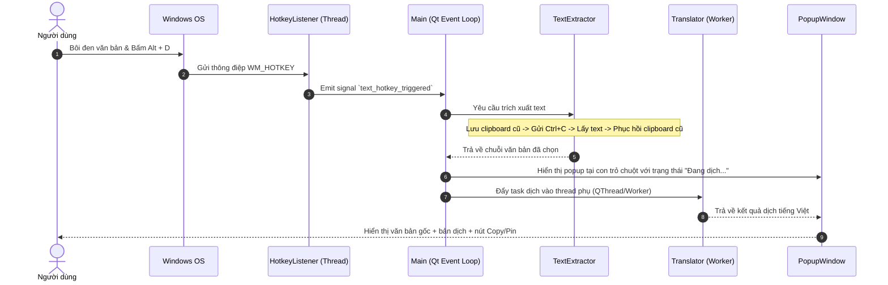
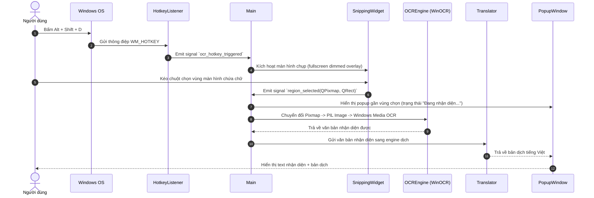
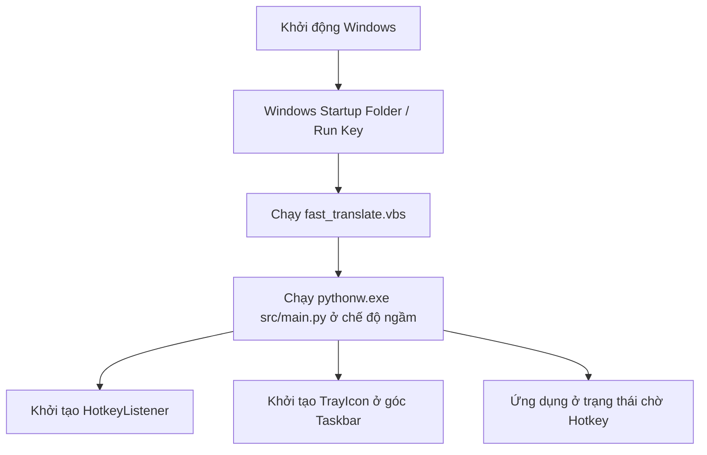

# 📐 FastTranslate - Architecture & Flow Tracking

Tài liệu thiết kế kiến trúc hệ thống, các luồng dữ liệu (Data Flow) và tương tác giữa các module trong ứng dụng FastTranslate.

---

## 1. Tổng quan hệ thống

FastTranslate là ứng dụng desktop chạy ngầm trên Windows, được xây dựng dựa trên:
- **PySide6 (Qt 6 for Python)**: Quản lý vòng đời ứng dụng, hệ thống sự kiện (Signals & Slots), giao diện Popup, Snipping Tool và System Tray Icon.
- **Windows Media OCR (`winocr`)**: Nhận diện chữ trực tiếp thông qua UWP/WinRT OCR API tích hợp sẵn trong Windows 10/11 (nhanh, offline, không cần cài Tesseract).
- **Google Translate / DeepL Engine (`deep-translator`)**: Dịch văn bản từ ngôn ngữ nguồn sang Tiếng Việt.
- **Windows User32 API (`RegisterHotKey` / `pynput`)**: Lắng nghe phím tắt toàn cục (Global Hotkeys) với độ trễ thấp và không xung đột phím.

---

## 2. Cấu trúc thư mục

```text
fast-translate/
├── assets/                  # Tài nguyên ứng dụng
│   ├── icon.ico            # Icon đa kích thước (16x16 -> 256x256) cho Tray & Taskbar
│   └── icon.png            # Icon định dạng PNG
├── docs/                   # Tài liệu hệ thống & theo dõi flow
│   ├── ARCHITECTURE.md     # Kiến trúc và luồng xử lý
│   ├── DEVELOPMENT_GUIDE.md# Hướng dẫn phát triển & chuẩn Git Flow
│   └── TROUBLESHOOTING.md  # Cẩm nang xử lý sự cố & các lỗi thường gặp
├── src/                    # Mã nguồn chính
│   ├── core/               # Tầng xử lý logic cốt lõi
│   │   ├── autostart.py    # Quản lý khởi động cùng Windows (Startup shortcut/registry)
│   │   ├── hotkey_listener.py # Lắng nghe phím tắt toàn cục qua Windows Message Loop
│   │   ├── ocr_engine.py   # Wrapper nhận diện chữ qua Windows Media OCR
│   │   ├── text_extractor.py # Trích xuất chữ bôi đen qua Clipboard giả lập
│   │   └── translator.py   # Wrapper gọi engine dịch thuật
│   ├── ui/                 # Tầng hiển thị giao diện người dùng
│   │   ├── popup_window.py # Cửa sổ Popup hiển thị bản dịch (Dark mode, auto-positioning)
│   │   ├── snipping_widget.py # Màn hình overlay kéo chọn vùng màn hình
│   │   ├── styles.py       # Hằng số màu sắc, font chữ và stylesheet QSS
│   │   └── tray_icon.py    # Icon khay hệ thống và menu ngữ cảnh
│   ├── config.py           # Quản lý cấu hình (đọc/ghi ~/.fast_translate/config.json)
│   └── main.py             # Entrypoint khởi tạo QApplication, kết nối Signals & Slots
├── tests/                  # Kiểm thử tự động
│   ├── test_evidence.py    # Test tích hợp xác minh tính năng (Evidence tests)
│   ├── test_ocr.py         # Test OCR nhận diện chữ
│   └── test_translator.py  # Test engine dịch
├── fast_translate.vbs      # Script VBScript khởi động ngầm không hiện cmd
├── run.bat                 # Script chạy nhanh từ Windows Explorer
├── run_debug.bat           # Script chạy ở chế độ debug hiện console log
└── requirements.txt        # Danh sách thư viện phụ thuộc
```

---

## 3. Các luồng xử lý chính (Data Flows)

### 3.1. Luồng 1: Dịch văn bản bôi đen (`Alt + D`)



### 3.2. Luồng 2: Dịch vùng chụp màn hình OCR (`Alt + Shift + D`)



### 3.3. Luồng 3: Khởi động cùng Windows (Autostart)



---

## 4. Cơ chế đồng bộ & Luồng (Threading)

1. **Main UI Thread (Qt Thread)**:
   - Chịu trách nhiệm render `PopupWindow`, `SnippingWidget`, xử lý tương tác bàn phím/chuột.
   - Tuyệt đối không thực hiện network request hoặc OCR đồng bộ trên Main Thread để tránh lag/đóng băng UI.

2. **Hotkey Listener Thread**:
   - Chạy riêng biệt bằng `QThread` hoặc background native message loop `GetMessageW` / `pynput`.
   - Khi phát hiện tổ hợp phím, dispatch an toàn về Main Thread qua cơ chế Qt Signal/Slot (thread-safe).

3. **Translation / OCR Workers**:
   - Tác vụ gọi Google Translate (HTTP network) hoặc Windows OCR được bọc trong các Worker Thread để cập nhật UI mượt mà với spinner/progress indicator.
